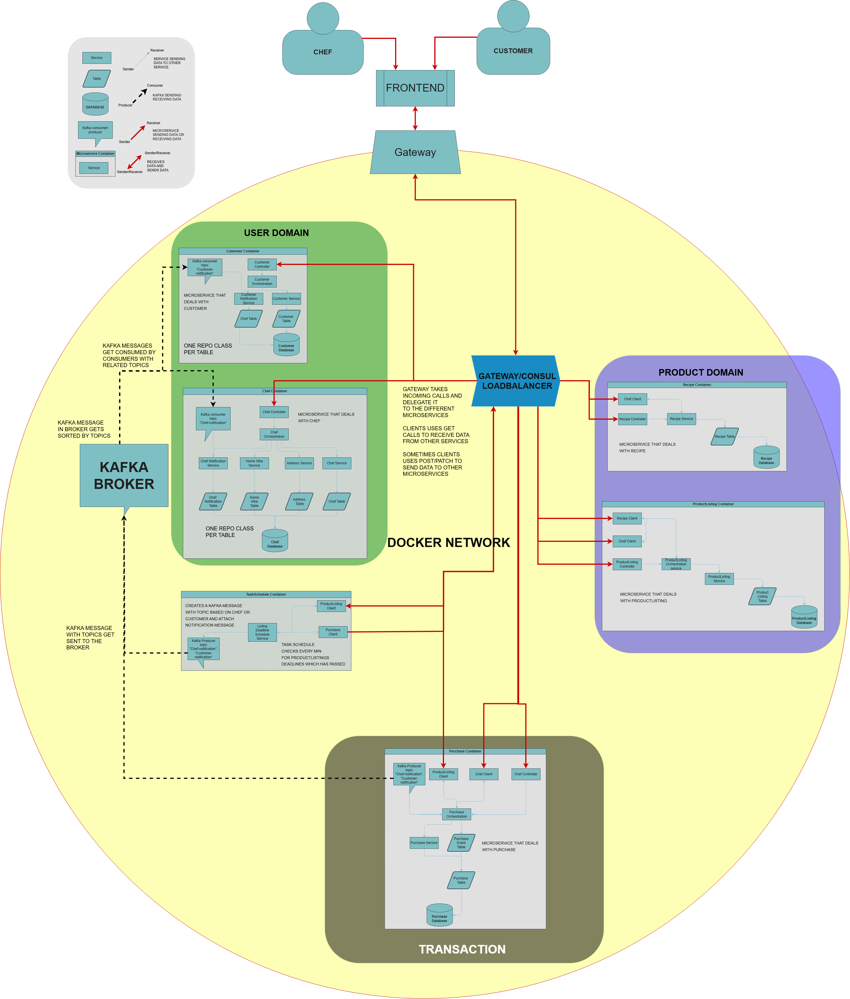
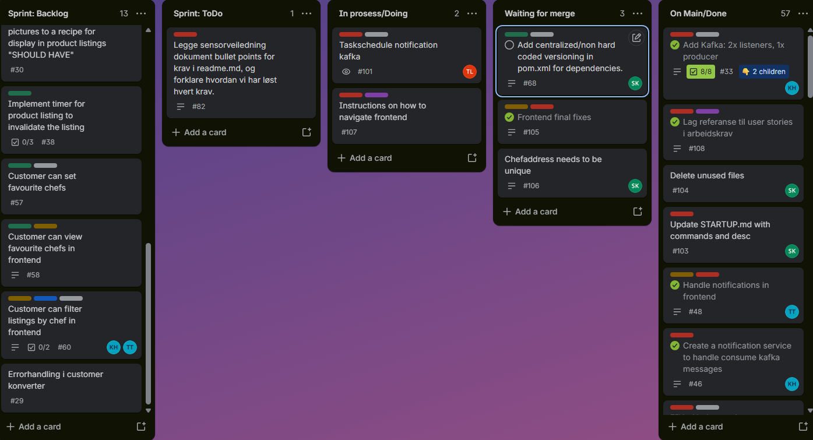

# HomeCookKitchen

## Overview

We are developing a social platform where home chefs can sell homemade meals to customers in their area. The idea came from a market analysis showing that food listings on Facebook Marketplace are grouped under kitchen appliances, which makes homemade food hard to find and compare. Our platform separates food into its own space and focuses on community rather than being a traditional e-commerce store.\
\
Instead of competing mainly on price, chefs can stand out through their food, their story, and their home setting. Each chef profile includes a “home vibe” that describes the atmosphere at the address, such as music, pets, outdoor seating, or whether the home is family friendly. Purchases are supported, but the emphasis is on the social experience.\
\
The current implementation includes the core functionality. Chefs can create recipe listings, and customers can browse and purchase from them. A background microservice checks for listings that have passed their deadline and closes them. Chefs and customers are notified when a purchase is made, or when a listing with a purchase reaches its deadline. A frontend with minimal endpoints supports a working demo.\
\
Due to time constraints, several social features are not yet implemented. These include favoriting chefs and customers, messaging, and discovering new chefs through random nearby listings from chefs the customer has not previously purchased from. These are planned for future development.

### Services:

| Service                  | Responsibility                                         |
|--------------------------|--------------------------------------------------------|
| `chef-service`           | Chefs, addresses, home vibes      , chef notifications |
| `customer-service`       | Customers   , customer notification                    |
| `recipe-service`         | Recipes                                                |
| `productlisting-service` | Product listings (portions, price, time and deadline)  |
| `purchase-service`       | Purchases of portions                                  |
| `taskscheduler-service`  | Scheduled job that checks listing deadlines            |
| `gateway`                | Single entry point, routing and load balancing         |
| `initdata`               | Creates test data on startup                           |
| `frontend`               | React web client                                       |

### Infrastructure components:

| Component              | Responsibility                                                |
|------------------------|---------------------------------------------------------------|
| `consul`               | Service discovery, health checks and central configuration (KV store) |
| `consul-importer`      | Loads `consul_kv.json` into Consul on startup                 |
| `kafka`                | Message broker for asynchronous events (notifications)        | 
|  `postgres`                      |    One PostgreSQL database per service                        |
| ELK (dev only)         | Centralized logging (Elasticsearch, Logstash, Kibana)         |
| `kafbat-ui` (dev only) | Web UI for inspecting Kafka topics and messages               |

The services communicate synchronously over REST through the gateway, and asynchronously through Kafka events (e.g. purchase to costumer/cook). Consul is used for service discovery, health checks and central configuration.

Zoomable picture is in the screenshot folder in root folder. "HomeCookKitchenArchitecture.png"
### Microservice requirements

| #  | Requirement           | How it is met                                                                                                             | See                             |
|----|-----------------------|---------------------------------------------------------------------------------------------------------------------------|---------------------------------|
| 7  | Gateway               | Spring Cloud Gateway on port 8100 routes `/api/**` to the services                                                        | [Access points](#access-points) |
| 8  | Load balancing        | Gateway routes use `lb://` and Spring Cloud LoadBalancer (round-robin) over Consul instances                              | [Scaling](#scaling)             |
| 9  | Health check          | All services register in Consul with a check on `/actuator/health`; only healthy instances get traffic (`query-passing`)  | [Verify](#verify)               |
| 10 | Docker Compose        | The whole system starts with `docker compose up`                                                                          | [Build and run](#build-and-run) |
| 11 | Central configuration | Consul KV, loaded from `consul/consul_kv.json`, with `prod` and `dev` profiles                                            | [Configuration](#configuration) |
| 12 | Multiple instances    | Unique `instance-id` per instance; scaling with `--scale`                                                                 | [Scaling](#scaling)             |

## Prerequisites

The only requirement is Docker Desktop.

Java, Maven and Node are not required locally. All services are built and run in Docker.
On the first run, all images and dependencies (Maven, npm) are downloaded automatically, so the first startup takes a few minutes.

## Build and run

`docker-compose.yml` runs the services with the `prod` profile. `docker-compose_dev.yml` runs them with the `dev` profile and also starts ELK and Kafka UI. These are development tools and are left out of prod to reduce resource usage and startup time.

```bash
# Prod
docker compose up -d --build

# Dev
docker compose -f docker-compose_dev.yml up -d --build
```

Startup takes about 1.5–2 minutes after the images are built.
Test data is created by the `initdata` service. Docker Compose starts it once all services and the gateway are healthy, and it uses a `CommandLineRunner` to create the data by calling the services through the gateway.
Test data therefore requires the full system to be started. 

### Verify

```bash
docker compose ps -a
```

All services should be `healthy`, and `initdata` should show `Exited (0)` when the test data has been created.
Registered services and their health checks can be seen in Consul at http://localhost:8500.

The frontend runs as a Docker container and starts together with the rest of the project. Open http://localhost:5173 in the browser.
Our frontend contains mock users for the examiner to test the functionality of the page. We have not implemented JWT credentials and have decided to store user credentials through React context. When you pick a chef or customer, their id and respective role is stored in the browser's sessionStorage. When closing a tab, opening a new tab, or clicking "Log out", the sessionStorage gets cleared.

## Stop

```bash
# Prod
docker compose down --remove-orphans

# Dev
docker compose -f docker-compose_dev.yml down --remove-orphans
```

## Scaling

Scaling is recommended with the prod setup (`docker-compose.yml`). The dev setup also runs ELK (Elasticsearch, Logstash, Kibana), which uses a lot of memory and can make the system slow or unstable when running several extra instances.

```bash
# Scale a service up (example: customer-service to 3 instances)
docker compose up -d --no-deps --scale customer-service=3 customer-service

# Scale back down
docker compose up -d --no-deps --scale customer-service=1 customer-service
```

`chef-service`, `customer-service`, `recipe-service`, `productlisting-service` and `purchase-service` can run in multiple instances behind the gateway.

`taskscheduler-service` runs as a single instance on purpose. It runs one scheduled job, and multiple instances would run the same job at the same time, causing duplicate calls (and duplicate notifications).

The gateway, frontend, Consul, Kafka and databases run as single instances (fixed host ports / container names).

## Access points

| Component           | URL / Port            |
|---------------------|-----------------------|
| Gateway             | http://localhost:8100 |
| Frontend            | http://localhost:5173 |
| Consul UI           | http://localhost:8500 |
| Kafka               | localhost:9092 |
| Kafka UI (dev)      | http://localhost:8090 |
| Kibana (dev)        | http://localhost:5601 |
| Elasticsearch (dev) | http://localhost:9200 |

### Services

All services are accessed through the gateway. Host ports are assigned by Docker.

| Service                | Container port | Gateway route            |
|------------------------|----------------|--------------------------|
| chef-service           | 8002           | `/api/chef/**`           |
| customer-service       | 8003           | `/api/customer/**`       |
| productlisting-service | 8006           | `/api/productListing/**` |
| recipe-service         | 8008           | `/api/recipe/**`         |
| purchase-service       | 8011           | `/api/purchase/**`       |
| taskscheduler-service  | 8020           | no route (internal)      |

### Databases

User: `username` / Password: `password`

| Database         | Port |
|------------------|------|
| chefDB           | 5432 |
| customerDB       | 5433 |
| productlistingDB | 5434 |
| purchaseDB       | 5435 |
| recipeDB         | 5436 |

## Configuration

Configuration is controlled centrally through Consul KV. The source is `consul/consul_kv.json`, which `consul-importer` loads into Consul on startup. The values can be seen (and edited live) in the Consul UI under **Key/Value** at http://localhost:8500.


After editing `consul_kv.json`, rebuild the importer:


```bash
docker compose build consul-importer
```

### Profiles

Each compose file sets a Spring profile (`SPRING_PROFILES_ACTIVE`): `prod` in `docker-compose.yml` and `dev` in `docker-compose_dev.yml`. The profile decides which keys the services read from Consul:

| Key                             | Applies to                          |
|---------------------------------|-------------------------------------|
| `config/application/data`       | all services (default / prod)       |
| `config/application,dev/data`   | all services in dev (overrides)     |
| `config/TaskScheduler/data`     | TaskScheduler (default / prod)      |
| `config/TaskScheduler,dev/data` | TaskScheduler in dev (overrides)    |

| Setting                         | prod         | dev        |
|---------------------------------|--------------|------------|
| SQL logging (`show-sql`)        | off          | on         |
| Stack trace in error responses  | never        | always     |
| Actuator endpoints              | health, info | all        |
| Health details                  | status only  | status + component details      |
| TaskScheduler logging           | INFO         | DEBUG      |
| Listing deadline check interval | every 30 s   | every 1 min |

The deadline check interval shows how the same code behaves differently depending on configuration from Consul.

Shared settings for all services, such as a unique `instance-id` (needed to run multiple instances) and `query-passing` (only healthy instances receive traffic), are also defined centrally.

Consul runs in dev mode (`agent -dev`), so the KV store is kept in memory. Changes made in the UI are lost on restart; permanent changes belong in `consul_kv.json`.


# List of user stories

#### User stories require that the containers are running and that you are logged in as a chef or customer respectively.

### A chef can create a listing

From arbeidskrav priority user story: 1. Post dish


As a chef, I want to create a listing so that people can attend my dinners. I'm logged in as a chef. I go to the left sidebar, click "Listings", then "+ Create Listing", and pick the recipe I want to make, as well as the address where I plan to serve it. I decide number of portions/seats, and how much I will be selling them for. I get information about what my maximum revenue could be. I set the deadline for customers to purchase by, as well as when I expect dinner to be served.

Acceptance criteria:

- The chef gets visual feedback when they have created a new listing

- The chef gets a dropdown menu with all their active recipes

- The chef gets a dropdown menu with all their active addresses

- The purchase deadline must be set to a future date and time; a deadline in the past is rejected

- There is meaningful visual feedback if a field is filled in wrong

- The chef gets a visual confirmation, and the listing immediately becomes visible in the Browse section (left sidebar) after a listing is created.


### A customer can browse dishes

From arbeidskrav priority user story: 2. Browse dishes

I am logged in as a customer and want to find a dinner to attend. I go to the left sidebar and click "Browse", which shows all active listings. For each listing I can see the name of the dish, which chef is serving it, the price per portion, how many seats are left, the chef's address, when the food is ready and a short description. To learn more, I click "More info & Order", which opens a detailed view where I can also see the food category, which allergens the dish contains, the chef's home vibe and the deadline for ordering.

Acceptance criteria:

- Only listings that are still within the order-by deadline are displayed.
- The name of the dish is prominently displayed as a title.
- The chef's name, address, price per portion, seats left, ready-by time and description are visible directly in the Browse list.
- The food category, allergens, home vibe and order-by deadline are displayed when "More info & Order" is clicked.

### A customer can make a purchase

From arbeidskrav priority user story: 3. Make purchase

I am logged in as a customer and have found a dinner I want to attend in "Browse". In the detailed view ("More info & Order"), I choose how many seats I want for me and my friends with the + and - buttons, where each seat includes one portion. I click "Add to order", which places the order immediately. I get a visual confirmation that the order went through, as well as a notification in the notification section (the mail icon in the left sidebar) showing what my order costs.

Acceptance criteria:

- I can choose the number of seats with the + and - buttons before ordering.
- The order is placed immediately when I click "Add to order".
- When I order, I get a visual confirmation that the order went through, as well as a notification showing the cost.


### A chef receives orders

From arbeidskrav priority user story: 4. Receive order

Now that you have made a purchase as a customer, you can see it from the chef's side. Log out and log in as the chef who owns the listing you ordered from. The test data also contains existing orders for Gordon Ramsay, so this works without placing an order first.

As a chef, I want to be notified when customers order from my listings, so that I know how many portions to prepare and for which customers. The mail icon in the left sidebar shows how many unread notifications I have. When I click it, I see a notification for each order, showing the dish, the number of seats, which customer ordered and when. I can mark each notification as read.

Acceptance criteria:

- The chef receives a notification when a customer orders from one of their listings.
- The notification shows the dish, the number of seats and which customer ordered.
- The mail icon shows the number of unread notifications.
- The chef can mark a notification as read.

The four user stories above are the priority stories from the arbeidskrav, adapted to how the project works today. All user stories can be found in [userstories.md](userstories.md).

### Contribution:

| Candidate      | Main responsibility                                              |
|----------------|------------------------------------------------------------------|
| Candidate   41 | Chef microservice, docker compose, profiles, consuler/gateway    |
| Candidate   37 | Customer microservice, Frontend                                  |
| Candidate   16 | Recipes microservice, ProductListing microservice, kafka service |
| Candidate   39 | Purchase microservice, initdata, taskscheduler                   |


The assignment board we used. (Trello)

Even if we had different main responsibility every candidate had a hand in several different services. Since we used an assignment board we knew what features was
important to get done. With this the candidate picked a task with a service where another candidate wasn't currently working on which helped us avoid merge conflicts. 
This structure of work helped us all to understand more about each other services and let us easily add new features to the different services as needed. \
\
A more in-depth explanation on what the candidates specifically contributed will be in the individual reflections as each candidate has had a hand in several places and it would be a lot to describe what everyone contributed with.
