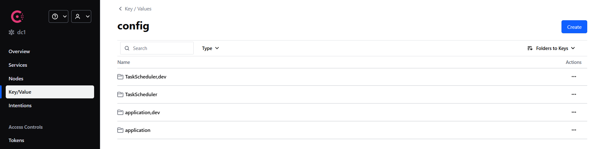

# HomeCookKitchen

## Overview

HomeCookKitchen is a platform where home chefs can sell meals from their own homes. A chef registers one or more addresses, each with a "home vibe" (music, pets, outdoor seating, family friendly), creates recipes, and publishes product listings with a limited number of portions, a price, a time and an order deadline. Customers browse the listings and purchase portions.

The system is built as microservices with Spring Boot and runs entirely in Docker:
PS JEG TRENGER HJELP MED Å JUSTERE DEN UNDER HER


| Service                  | Responsibility                                                        |
|--------------------------|-----------------------------------------------------------------------|
| `chef-service`           | Chefs, addresses, home vibes                  |
| `customer-service`       | Customers                                   |
| `recipe-service`         | Recipes                                                               |
| `productlisting-service` | Product listings (portions, price, time and deadline)                 |
| `purchase-service`       | Purchases of portions                                                 |
| `taskscheduler-service`  | Scheduled job that checks listing deadlines                           |
| `gateway`                | Single entry point, routing and load balancing                        |
| `initdata`               | Creates test data on startup                                          |
| `frontend`               | React web client                                                      |

The services communicate synchronously over REST through the gateway, and asynchronously through Kafka events (e.g. purchase to costumer/cook). Consul is used for service discovery, health checks and central configuration.

TRENGER HJELP MED Å JUSTERE DENNE
### Microservice requirements

| #  | Requirement           | How it is met                                                                                                             | See                             |
|----|-----------------------|---------------------------------------------------------------------------------------------------------------------------|---------------------------------|
| 7  | Gateway               | Spring Cloud Gateway on port 8100 routes `/api/**` to the services                                                        | [Access points](#access-points) |
| 8  | Load balancing        | Gateway routes use `lb://` and Spring Cloud LoadBalancer (round-robin) over Consul instances                              | [Scaling](#scaling)             |
| 9  | Health check          | All services register in Consul with a check on `/actuator/health`; only healthy instances get traffic (`query-passing`)  | [Verify](#verify)               |
| 10 | Docker Compose        | The whole system starts with `docker compose up`                                                                          | [Build and run](#build-and-run) |
| 11 | Central configuration | Consul KV, loaded from `consul/consul_kv.json`, with `prod` and `dev` profiles                                            | [Configuration](#configuration) |
| 12 | Multiple instances    | Unique `instance-id` per instance; scaling with `--scale`                                                                 | [Scaling](#scaling)             |

## Prerequisites

The only requirement is Docker Desktop.

Java, Maven and Node are not required locally. All services are built and run in Docker.
On the first run, all images and dependencies (Maven, npm) are downloaded automatically, so the first startup takes a few minutes.

## Build and run

`docker-compose.yml` runs the services with the `prod` profile. `docker-compose_dev.yml` runs them with the `dev` profile and also starts ELK and Kafka UI. These are development tools and are left out of prod to reduce resource usage and startup time.

```bash
# Prod
docker compose up -d --build

# Dev
docker compose -f docker-compose_dev.yml up -d --build
```

Startup takes about 1.5–2 minutes after the images are built.
Test data is created by the `initdata` service. Docker Compose starts it once all services and the gateway are healthy, and it uses a `CommandLineRunner` to create the data by calling the services through the gateway.
Test data therefore requires the full system to be started. 

### Verify

```bash
docker compose ps -a
```

All services should be `healthy`, and `initdata` should show `Exited (0)` when the test data has been created.
Registered services and their health checks can be seen in Consul at http://localhost:8500.

The frontend runs as a Docker container and starts together with the rest of the project. Open http://localhost:5173 in the browser.
Our frontend contains mock users for the examiner to test the functionality of the page. We have not implemented JWT credentials and have decided to store user credentials through React context. When you pick a chef or customer, their id and respective role is stored in the browser's sessionStorage. When closing a tab, opening a new tab, or clicking "Log out", the sessionStorage gets cleared.

## Stop

```bash
# Prod
docker compose down --remove-orphans

# Dev
docker compose -f docker-compose_dev.yml down --remove-orphans
```

## Scaling

Scaling is recommended with the prod setup (`docker-compose.yml`). The dev setup also runs ELK (Elasticsearch, Logstash, Kibana), which uses a lot of memory and can make the system slow or unstable when running several extra instances.

```bash
# Scale a service up (example: customer-service to 3 instances)
docker compose up -d --no-deps --scale customer-service=3 customer-service

# Scale back down
docker compose up -d --no-deps --scale customer-service=1 customer-service
```

`chef-service`, `customer-service`, `recipe-service`, `productlisting-service` and `purchase-service` can run in multiple instances behind the gateway.

`taskscheduler-service` runs as a single instance on purpose. It runs one scheduled job, and multiple instances would run the same job at the same time, causing duplicate calls (and duplicate notifications).

The gateway, frontend, Consul, Kafka and databases run as single instances (fixed host ports / container names).

## Access points

| Component           | URL / Port            |
|---------------------|-----------------------|
| Gateway             | http://localhost:8100 |
| Frontend            | http://localhost:5173 |
| Consul UI           | http://localhost:8500 |
| Kafka               | localhost:9092 |
| Kafka UI (dev)      | http://localhost:8090 |
| Kibana (dev)        | http://localhost:5601 |
| Elasticsearch (dev) | http://localhost:9200 |

### Services

All services are accessed through the gateway. Host ports are assigned by Docker.

| Service                | Container port | Gateway route            |
|------------------------|----------------|--------------------------|
| chef-service           | 8002           | `/api/chef/**`           |
| customer-service       | 8003           | `/api/customer/**`       |
| productlisting-service | 8006           | `/api/productListing/**` |
| recipe-service         | 8008           | `/api/recipe/**`         |
| purchase-service       | 8011           | `/api/purchase/**`       |
| taskscheduler-service  | 8020           | no route (internal)      |

### Databases

User: `username` / Password: `password`

| Database         | Port |
|------------------|------|
| chefDB           | 5432 |
| customerDB       | 5433 |
| productlistingDB | 5434 |
| purchaseDB       | 5435 |
| recipeDB         | 5436 |

## Configuration

Configuration is controlled centrally through Consul KV. The source is `consul/consul_kv.json`, which `consul-importer` loads into Consul on startup. The values can be seen (and edited live) in the Consul UI under **Key/Value** at http://localhost:8500.



After editing `consul_kv.json`, rebuild the importer:


```bash
docker compose build consul-importer
```

### Profiles

Each compose file sets a Spring profile (`SPRING_PROFILES_ACTIVE`): `prod` in `docker-compose.yml` and `dev` in `docker-compose_dev.yml`. The profile decides which keys the services read from Consul:

| Key                             | Applies to                          |
|---------------------------------|-------------------------------------|
| `config/application/data`       | all services (default / prod)       |
| `config/application,dev/data`   | all services in dev (overrides)     |
| `config/TaskScheduler/data`     | TaskScheduler (default / prod)      |
| `config/TaskScheduler,dev/data` | TaskScheduler in dev (overrides)    |

| Setting                         | prod         | dev        |
|---------------------------------|--------------|------------|
| SQL logging (`show-sql`)        | off          | on         |
| Stack trace in error responses  | never        | always     |
| Actuator endpoints              | health, info | all        |
| Health details                  | status only  | status + component details      |
| TaskScheduler logging           | INFO         | DEBUG      |
| Listing deadline check interval | every 30 s   | every 1 min |

The deadline check interval shows how the same code behaves differently depending on configuration from Consul.

Shared settings for all services, such as a unique `instance-id` (needed to run multiple instances) and `query-passing` (only healthy instances receive traffic), are also defined centrally.

Consul runs in dev mode (`agent -dev`), so the KV store is kept in memory. Changes made in the UI are lost on restart; permanent changes belong in `consul_kv.json`.